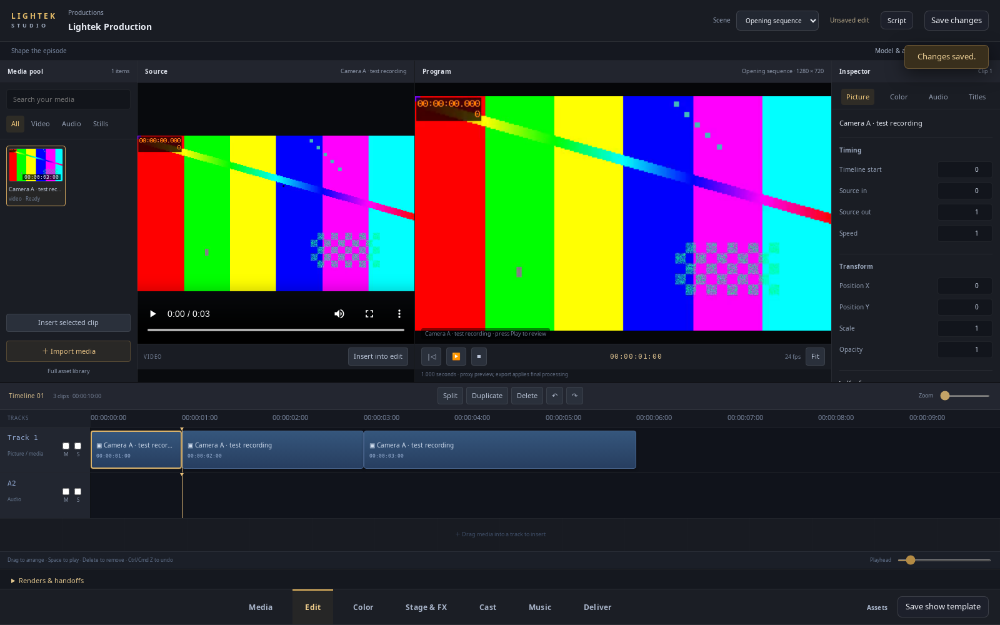
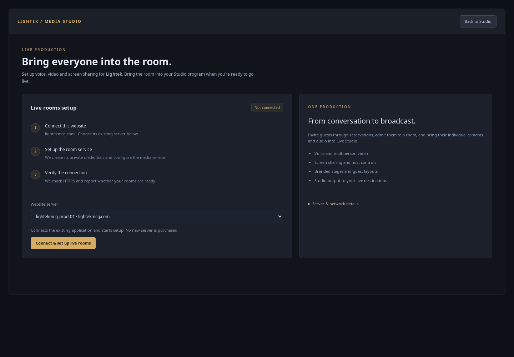

# Lightek Media Studio

Open **Dashboard → Media Studio** (the existing Studio & broadcasting route). The production library replaces the old control-room list as the entry point. Open a production to enter the full-window editor. Use **Productions** in its header to return to the library.

## Start an edit

Choose **New production**, name it, and create it. An empty 1080p / 24 fps sequence is saved without starting Blender, buying a service or rendering a scene. Import your footage, sound or stills from the media pool. Imports show their preparation status before they can be inserted.

Select a media item to review its source. **Insert selected clip** places it into the sequence; dragging it onto a track chooses the position and lane. Program shows the assembled sequence, using the existing media preview engine.

- **Edit:** select timeline clips; move them between tracks; split at the playhead, duplicate, remove, undo and redo. Picture timing, source trims, speed, position, scale and opacity live in the inspector.
- **Color:** adjust the selected clip's brightness, contrast and saturation with preview feedback. These are the existing processing controls, not a new color-science or scopes engine.
- **Audio inspector:** clip gain, fades, low cut, mute, export noise reduction, track gain and pan. Track headers provide mute and solo.
- **Titles inspector:** place a title at the playhead and change text, timing, position and size. Position/gain keyframes remain editable in the inspector.
- **Music:** the existing editable beat/instrument workstation and score-to-edit bounce remain in the same production.
- **Stage & FX / Cast:** open the scene, direct characters, or use the model/animation and camera tools without changing projects.
- **Deliver:** use existing render/export quotes and release controls. Finished shots still enter through Renders & handoffs.

Use **Save changes** to persist the edit. Unsaved drafts survive section and scene switches in the current browser session. Space plays/pauses, Delete removes the selected clip, and Ctrl/Cmd Z (Shift for redo) operates within the editor, while text fields retain normal editing shortcuts. On smaller screens the source viewer collapses, a bin insertion button stays available, and the inspector stacks below the program view.

## Live rooms setup

From the production library choose **Live rooms setup**. A matching existing Gatekeeper project can now be connected and activated with **Connect & set up live rooms**. The server hostname and account must match the website; server ownership and active state are checked. Existing installations offer **Set up live rooms** / **Verify live rooms**. The page refreshes during setup and reports a safe failure message and retry action.

The central production application's deliberate exclusion from fleet updates remains. Media setup can explicitly register that runtime without making it eligible for central-app fleet updates. A website with no matching server project receives a direct **Connect an existing server** action; the application cannot infer or purchase an unknown server.

The release installer copies the local media installer to a root-owned fixed path and validates a sudo policy for exactly that helper command. Local activation can run it through the existing job/transport, without requiring a password prompt or granting a general privileged shell to the web user. Remote installations continue through their existing authorized Gatekeeper transport. Credentials stay in Vault and are not shown on the setup page.

Activation still requires working HTTPS, sufficient memory, a connected runtime and provider firewall access. Installing the release prepares the setup capability; it does not automatically activate LiveKit or prove public-network video connectivity. Verify an actual call after activation.

## Validation and boundaries

The real-browser workbench test decodes generated test media and checks source/program views, insert, split, undo/redo, color, track pan, saving and keyboard edits. The existing production browser suite covers scene drafts and handoffs at desktop, tablet and phone widths. Server-side tests cover creation without Blender, idempotency/site scope, existing-runtime registration and access rejection. Local helper tests cover the fixed program/policy and symlink rejection.

This is a native editor UX and setup-flow change over the existing engines. Neural face replacement/lip sync, full Resolve/Blender feature parity, professional color scopes and automatic assembly across separate scenes remain outside this change. The footage in browser-test screenshots is generated test material, not a finished production.

Deploy through the normal release pipeline, including migrations and worker restart. Migration `RegisterMediaStudioProjectCreate` registers the project-creation capability. The deploy step installs the fixed local setup helper. Dashboard assets and the shared PWA cache advance to version 61.

## Import and editing workflow repair

Uploads now have per-file progress and failures. Retry repeats only the failed step: a successful upload is reused if asset registration fails, with the same idempotency key. Other files can finish while one fails. Drop files into the editor or use Import media; preparation progresses into ready media in the pool. Leaving with active uploads triggers the browser's leave-page guard.

Review a source and use Mark in / Mark out, or enter the source range. Append selected clip adds that range after the last clip on its picture/audio track. Drag onto a lane to choose its position. Drag either clip edge to trim; undo restores the edit. Click the ruler or an empty lane to seek, select a clip to preview its beginning, and split inside the selected clip. Empty sequences can be saved, while export still requires media.

Pool updates and inspector edits preserve the source media element, program canvas and inspector focus. Reopening a saved edit draws its program image once prepared media loads. Browser tests exercise actual MP4 decoding and multipart uploads through HTTP fixtures, including upload and registration recovery, preparation, source marks, pointer trims, uninterrupted playback, save/reopen and mobile layout.

See [AI Studio](ai-studio.md) for the self-hosted generation integration and its current boundaries.

## Input and import access repair

The project-name form now stays connected while asset/template lists refresh. Shared Dashboard text-field handling preserves a replaced active field's value, caret and selection within the same scene/view; it does not steal focus across scene changes. Composition input defers background redraws until composition ends. Native inspector background refreshes use the same focus preservation.

Import media is a button at the top of the pool. The empty-state plus is also a working import button. A persistent file input survives background redraws while the operating system's picker is open; it is opened synchronously from the button click for browser user-activation compatibility. Secondary pool controls scroll independently in short workspaces.

Browser regression checks type project names one letter at a time through real asset-list refresh requests, preserve selection and composition, continue writing a script after refresh, and open both file-picker buttons. The import test refreshes the pool while the picker is open before selecting the real test media.
