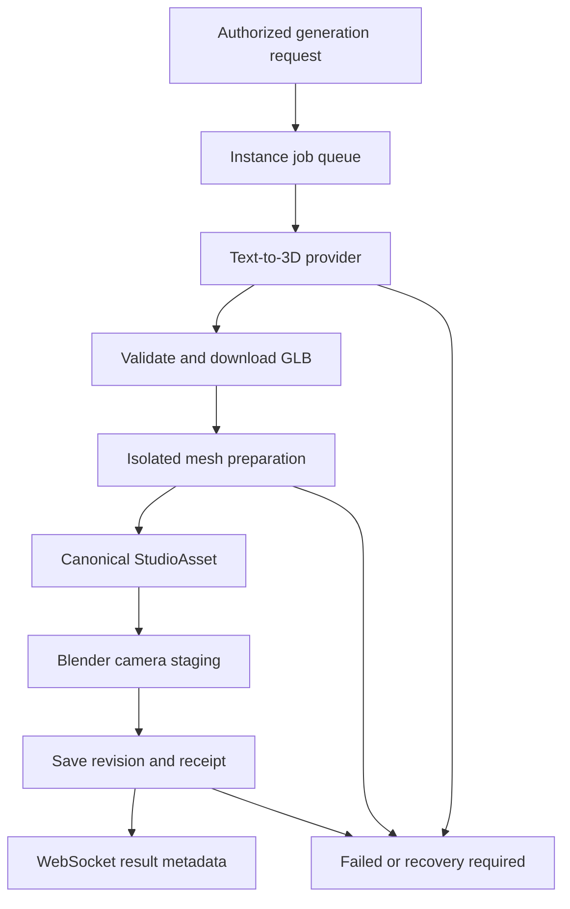

# Persistent Blender viewport implementation

The shipped PWA Spatial / 4D workspace now has **Connect Blender**, a live video viewport, camera selection, lens preview/save, integer-frame scrubbing and render/decoded FPS plus RTT readouts. `useBlenderStream.ts` wraps the same compiled client used by the PWA. This is a separate interactive viewport service; the existing Live Studio broadcasting encoder and public live routes are unchanged.

## Process and protocol

Rails authorizes the current user/site with the existing Studio policy and prepares a private per-session manifest plus native Blender/GLB dependencies. An authenticated loopback request starts one persistent Blender process. The browser receives a five-minute, scene/user/session-bound HMAC ticket, never the service secret. Configure the allowed WebSocket origins and short-lived TURN credentials for internet deployments.

Canonical JSON Schema: `config/studio/protocol/spatial-ws-v1.schema.json`. Every message has version, session ID, unique message ID, monotonically increasing client sequence, canonical scene revision and a typed payload. Matrices are column-major, camera-to-world, Blender Z-up, meters. Quaternions are XYZW. Timeline frames include BOTH zero-based editor frame and absolute Blender frame plus rational FPS; mismatches are rejected. Viewer parallax uses a disposable camera copy; only explicit shot commits persist.

The AsyncIO sidecar validates incoming messages and owns network sockets and encoding. The Blender process runs `stage_manifest` once and executes bpy/GPU operations on its main thread. IPC uses stdin JSON commands and a private FIFO carrying length-prefixed metadata/pixel buffers. The latest received frame replaces the previous pending frame; previews coalesce by target and saved edits have a bounded queue. This avoids accumulating a render backlog.

`GPUOffScreen` reads GPU color into CPU memory and writes the FIFO without image files. This is **GPU readback, not zero-copy encoding**. It requires a valid VIEW_3D GPU context: plain `--background` cannot provide this path. The explicit background render fallback writes/deletes a temporary JPEG; it supports diagnosing deployments and is not the no-disk GPU path. EEVEE is the interactive target. Cycles complex scenes do not have a guaranteed 60 fps mode.

The no-disk path still performs CPU readback and color conversion; use GPU/native interop only after measuring the copies.

The encoder uses PyAV/libx264, or configured h264_nvenc, with zero B frames, no lookahead and a 60 fps time base. Encoded H.264 packets are sent by aiortc without its default 30 fps re-encoder. Actual unique Blender frame rate and decoded frame rate are reported separately; repeated frames do not count as new renders. H.264 is the implemented negotiated codec; VP8/AV1 are not silently advertised. The isolated RTP timestamp hook is pinned to aiortc 1.15.0 and must be retested on upgrades.

## Saved changes and reconnects

Rails remains canonical. Lens/shot/object commits require the matching `StudioScene.lock_version` and save a receipt with the scene in the same database transaction. A retry with the same ID/content returns its prior revision. Camera matrices reject scale/shear; native object overrides use the runner's world-space transform convention. The current mounted panel saves lens changes and the selected shot camera; transform gizmo wiring uses the exported protocol client and is not mounted here yet.

The client coalesces previews, retains unacknowledged saved edits, reconnects with jitter/backoff, refreshes tickets and renegotiates WebRTC. Sent commands preserve their original revision and ID on retry. A changed worker epoch with uncertain saves requests reconciliation rather than blindly replaying them. A worker failure after canonical persistence requires reopening from the saved manifest; it must not report the failed runtime edit as applied.

## Honest latency telemetry

Data Channel ping is network/application round-trip time. Frame presentation acknowledgement measures server capture → browser presentation → server acknowledgement using the same server monotonic clock. It is a frame round trip, **not one-way glass-to-glass latency**. RTP-correlated metadata matches the browser's `requestVideoFrameCallback.rtpTimestamp`; unsupported browsers still show video but do not fabricate frame telemetry. No face/webcam frames are uploaded by tracking.

The loopback test executes real Blender, H.264 encoding, ICE/DTLS/SRTP and decode, moves an object, and verifies changed received pixels in the same worker process. A CPU proof produced a warmed render near 10 ms at 160×90; this is not a production 720p/60fps or WAN sub-50ms benchmark. Measure p50/p95 render, encode, frame-presentation RTT, loss and decoded FPS on the deployed GPU, LAN and TURN routes before claiming the target. GPU viewport capture is implemented but unverified in this CPU-only workspace.

## Deployment on each customer's instance

1. Install a compatible Blender build and Python 3.12 virtual environment. Install `services/spatial/requirements.txt` into that environment. Rails/Passenger remains the application host.
2. Copy `deploy/spatial/spatial.env.example` to a private environment file, generate a secret with `openssl rand -hex 32`, and provide the same root/secret to Rails. The Rails and sidecar service users need access to the session directory. Configure real domain/origin, Blender path and commit callback URL. Do not use the example secret.
3. Adapt `deploy/spatial/lightek-spatial.service` to the installation paths/user; create its writable directory. Add the Apache WebSocket proxy to the TLS vhost. ICE needs UDP reachability or authenticated TURN; proxying WebSockets alone does not carry WebRTC video.
4. Start the render backend, connect a basic cube scene and verify visible controls. Then configure an isolated GPU-backed display and set backend=viewport; verify real capture before enabling it for users. NVENC requires a PyAV/FFmpeg build exposing the encoder and compatible GPU drivers; service startup is not a hardware capability certificate.
5. Keep service HTTP on loopback. Apply instance CPU/GPU/memory limits. Native .blend parsing should run within your existing isolated Blender container policy; do not expose arbitrary file/network import paths. The service launches constrained Docker workers when SPATIAL_CONTAINER_IMAGE is configured; native execution requires explicit SPATIAL_ALLOW_NATIVE=1. GPU container/display integration is deployment-specific and is not installed automatically by this PR.

The health endpoint reports binary availability and active sessions, not a successful GPU render. An unavailable service produces a visible configuration error in Studio.

## Text-to-stage and compositing boundaries

`services/spatial/assets.py` provides a bounded durable SQLite job queue, restart recovery, owner-bound idempotency, and size/time-limited public-HTTPS GLB downloads with DNS/address validation. `tripo.py` is a Tripo v3 asynchronous adapter. `blender/spatial_optimize.py` optimizes static meshes and resizes textures in an isolated preparation process; animated/rigged meshes are not decimated. `spatial_asset_staging.py` performs actual camera-frustum fitting/PBR defaults; the worker supports backend-only STAGE_ASSET and creates collision/rig anchors. Anchors are metadata, not an automatic character rig or physics simulation.

These pieces are integration primitives: no paid provider is configured, no generation button is exposed, and canonical generated-asset persistence/job endpoints are not yet wired into the PWA. A backend job should generate → approved-host download → optimize → import to StudioAsset → stage → save its final transform with optimistic locking → send metadata. Preserve original/provider provenance and retry receipts. Do not trigger billing from speculative scene previews.

The compositor now accepts float confidence masks and targets up to 60 inference requests/sec with one in flight, worker GPU segmentation with CPU fallback and measured inference duration. Head tracking is throttled independently. Hardware throughput is measured, not promised. Alpha is not depth: optional relief requires a separate estimated depth map.

`server-depth.js` provides a shared-depth-buffer pass for an explicitly matched color bitmap and normalized OpenGL depth texture; subsequent Three meshes can depth-test in front/behind it using the supplied server view/projection. The GPU viewport backend captures a bounded 160×90 normalized depth pass, compresses it in the same frame packet, and sends it with RTP-correlated metadata. The client holds at most three matching color snapshots and the opt-in live-panel checkbox applies the paired depth to a shared depth buffer. The webcam plane is placed two meters down the server camera axis. This provides layered occlusion, not calibrated physical person geometry; it holds the server camera projection and does not locally head-shift the rendered pixels. Background render fallback provides no depth. Synthetic WebGL tests verify front/behind behavior and reject mismatched frame IDs; actual Blender GPU depth capture still requires deployment hardware validation. Flat video cannot reveal hidden surfaces when the viewer moves; request a new server camera render or ship actual scene geometry.

## Asset job routing

Provider/queue/optimizer/stager implementations are supplied; the canonical asset and job API integration points above remain future wiring, not an enabled production generation flow.
